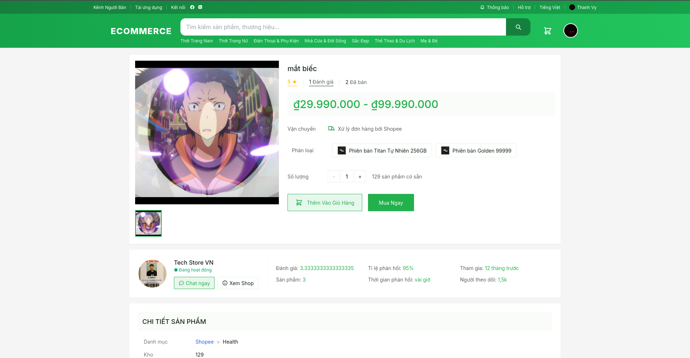
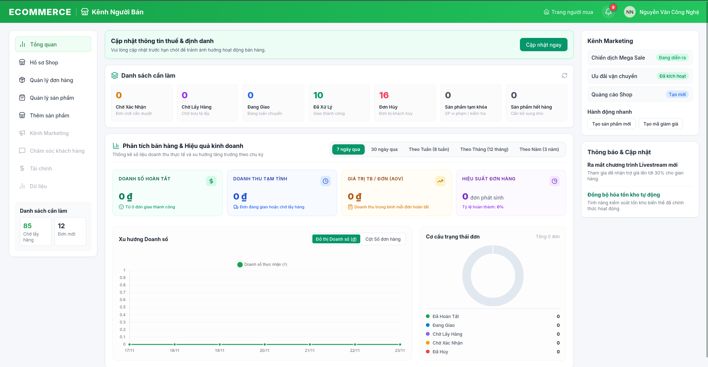

# 1. Ecommerce Marketplace

Sàn mua sắm trực tuyến kết nối người mua với các gian hàng độc lập.

## 2. Tính năng chính

- **Người mua:** Tìm kiếm, lọc sản phẩm theo giá và đánh giá, quản lý giỏ hàng và địa chỉ, đặt hàng, theo dõi đơn và viết đánh giá.
- **Người bán:** Đăng ký gian hàng, tạo sản phẩm và biến thể, nhập kho, xử lý đơn hàng và xem thống kê bán hàng.
- **Quản trị viên:** Quản lý người dùng, vai trò, gian hàng, danh mục, thuộc tính sản phẩm và phí hoa hồng.
- **Thông báo:** Cập nhật trạng thái đơn hàng theo thời gian thực.

## 3. Ảnh demo

**Trang chủ**


**Chi tiết sản phẩm**



**Dashboard người bán**



## 4. Hướng dẫn cài đặt

Cài **JDK 21**, **Node.js 22.12+** (kèm npm) và **Docker Compose v2**. API dùng Maven Wrapper có sẵn trong repo.

### Windows

Cài JDK và Node.js bản Windows, [Git for Windows](https://gitforwindows.org/) và [Docker Desktop](https://docs.docker.com/desktop/setup/install/windows-install/). Khởi động Docker Desktop rồi mở PowerShell tại thư mục dự án.

### macOS

Cài JDK và Node.js đúng kiến trúc Apple Silicon hoặc Intel. Cài và mở [Docker Desktop cho Mac](https://docs.docker.com/desktop/setup/install/mac-install/), rồi mở Terminal tại thư mục dự án.

### Linux

Cài JDK và Node.js phù hợp với bản phân phối. Cài [Docker Engine và Compose plugin](https://docs.docker.com/compose/install/linux/), khởi động Docker và kiểm tra tài khoản hiện tại chạy được `docker compose version`. Mở terminal tại thư mục dự án.

### Cấu hình và chạy

1. **Khởi động hạ tầng.** Mở Docker Desktop trên Windows hoặc macOS, hoặc khởi động Docker Engine trên Linux. Từ thư mục gốc của repo, chạy Compose để bật MySQL, Redis và RabbitMQ. Chờ các dịch vụ sẵn sàng, đặc biệt là MySQL khi khởi tạo lần đầu, rồi mới chạy API.

   <pre><code>docker compose up -d
   docker compose ps</code></pre>

2. **Chuẩn bị file `.env`.** Tạo file ở thư mục gốc, cùng cấp với `docker-compose.yml`.

   ```dotenv
   VITE_API_URL=http://localhost:8080/api/v1
   VITE_NOTIFICATION_URL=http://localhost:3000
   ```

   Điền cấu hình Cloudinary qua `CLOUDINARY_CLOUD_NAME`, `CLOUDINARY_API_KEY` và `CLOUDINARY_API_SECRET`. Cấu hình SMTP nếu cần gửi email xác thực và `VITE_GOOGLE_CLIENT_ID` nếu dùng đăng nhập Google.

3. **Chạy API bằng IntelliJ IDEA 2026.**
   - Mở thư mục gốc của repo. Nếu IntelliJ chưa nhận Maven module, nhấp phải vào `apps/api/pom.xml` và chọn **Add as Maven Project**.
   - Mở lớp `EcommerceApplication`. Nếu chưa có cấu hình chạy, tạo cấu hình cho lớp này từ nút Run cạnh hàm `main`.
   - Vào **Run → Edit Configurations** và chọn `EcommerceApplication`. Chọn JDK 21 và đặt **Working directory** thành `$PROJECT_DIR$/apps/api`.
   - Chọn **Modify options → Environment variables**. Ở trường **Environment variables**, bấm **Browse for .env files and scripts** rồi chọn file `.env` ở thư mục gốc.
   - Bấm **Apply → OK**, sau đó chạy `EcommerceApplication`. API mặc định chạy ở cổng `8080`.

   [Hướng dẫn nạp file .env của JetBrains](https://www.jetbrains.com/help/idea/program-arguments-and-environment-variables.html#environment-variables)

4. **Cài dependencies cho web và realtime gateway.** Từ thư mục gốc, chạy:

   <pre><code>npm --prefix apps/web ci
   npm --prefix apps/realtime-gateway ci</code></pre>

5. **Chạy realtime gateway.** Mở một terminal tại thư mục gốc. Gateway đọc file `.env` ở root, nhận sự kiện từ RabbitMQ và gửi thông báo đến web qua Socket.IO. Cổng mặc định là `3000`.

   <pre><code>npm run dev:realtime</code></pre>

6. **Chạy frontend.** Mở terminal thứ hai tại thư mục gốc. Vite đọc file `.env` ở root.

   <pre><code>npm run dev:web</code></pre>

## 5. Cách sử dụng

Mở web tại [localhost:5173](http://localhost:5173).

- **Mua hàng:** Đăng nhập, tìm hoặc lọc sản phẩm, chọn biến thể nếu có rồi thêm vào giỏ. Chọn địa chỉ và phương thức thanh toán, sau đó đặt hàng. Theo dõi trạng thái trong **Đơn mua** và đánh giá sản phẩm sau khi đơn hoàn tất.
- **Bán hàng:** Mở **Kênh người bán**, đăng ký gian hàng, thêm sản phẩm và nhập tồn kho. Khi có đơn, xử lý đơn trong trang quản lý và theo dõi doanh số trên dashboard.
- **Quản trị:** Đăng nhập bằng tài khoản admin để quản lý gian hàng, người dùng, danh mục, quyền và phí hoa hồng.

Tài liệu API có tại [Swagger UI](http://localhost:8080/api/v1/swagger-ui/index.html).

## 6. Công nghệ sử dụng

- **Frontend** — React, Vite, Redux Toolkit, React Router, Tailwind CSS, daisyUI.
- **Backend API** — Java 21, Spring Boot, Spring Security, Spring Data JPA, Maven.
- **Cơ sở dữ liệu, cache và lưu trữ ảnh** — MySQL 8, Flyway, Redis, Cloudinary.
- **Messaging và realtime** — RabbitMQ, Node.js, Express, Socket.IO.
- **Hạ tầng và CI** — Docker, Docker Compose, GitHub Actions.
