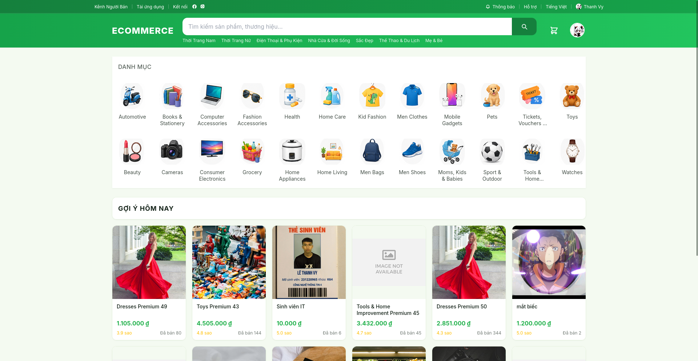

# 🛒 Ecommerce Marketplace

Sàn thương mại điện tử nhiều người bán. Người mua tìm sản phẩm và đặt hàng, người bán quản lý gian hàng và tồn kho, quản trị viên theo dõi hoạt động toàn sàn.

## ✨ Tính năng chính

- **Người mua:** Tìm kiếm, lọc sản phẩm theo giá và đánh giá, quản lý giỏ hàng và địa chỉ, đặt hàng, theo dõi đơn và viết đánh giá.
- **Người bán:** Đăng ký gian hàng, tạo sản phẩm và biến thể, nhập kho, xử lý đơn hàng và xem thống kê bán hàng.
- **Quản trị viên:** Quản lý người dùng, vai trò, gian hàng, danh mục, thuộc tính sản phẩm và phí hoa hồng.
- **Thông báo:** Cập nhật trạng thái đơn hàng theo thời gian thực.

## 📸 Ảnh demo

Ảnh demo sẽ được bổ sung. Các màn dự kiến gồm trang chủ, giỏ hàng và dashboard người bán.

<!--
Sau khi chụp, đặt ảnh vào docs/images/ rồi hiển thị các dòng sau:



-->

## ⚙️ Hướng dẫn cài đặt

**Yêu cầu:** Java 21, Node.js 22.12 trở lên, npm và Docker Compose.

1. Clone repo, mở terminal tại thư mục gốc và cài dependencies.

   ```bash
   npm ci
   npm --prefix apps/web ci
   npm --prefix apps/realtime-gateway ci
   ```

2. Tạo file `.env` ở thư mục gốc. Khi chạy local với cổng mặc định, frontend có thể dùng cấu hình sau.

   ```dotenv
   VITE_API_URL=http://localhost:8080/api/v1
   VITE_NOTIFICATION_URL=http://localhost:3000
   ```

   Điền thêm cấu hình RabbitMQ nếu dùng broker riêng. Các tính năng gửi email, đăng nhập Google và tải ảnh sản phẩm cần cấu hình SMTP, Google Client ID và Cloudinary tương ứng. Giữ thông tin nhạy cảm trong `.env` trên máy.

3. Khởi động MySQL, Redis và RabbitMQ, rồi chạy cả ba ứng dụng. Ví dụ dưới đây dùng Bash. File `.env` cần có cú pháp gán biến tương thích với Bash để Spring Boot nhận được các biến đã export.

   ```bash
   docker compose up -d
   set -a
   source ./.env
   set +a
   npm run dev
   ```

   Có thể chạy riêng từng phần bằng `npm run dev:api`, `npm run dev:web` hoặc `npm run dev:realtime`. Nếu dùng IntelliJ, mở repo ở thư mục gốc và import [Maven project của API](apps/api/pom.xml).

## 🚀 Cách sử dụng

1. Mở [giao diện web](http://localhost:5173), đăng nhập và chọn sản phẩm.
2. Thêm sản phẩm vào giỏ, chọn địa chỉ giao hàng và đặt đơn. Xem tiến trình trong **Đơn mua**.
3. Vào **Kênh người bán** để đăng ký gian hàng, đăng sản phẩm và xử lý đơn. Tài khoản admin có thể vào trang quản trị để quản lý sàn.

API chạy mặc định ở `http://localhost:8080/api/v1`. Có thể xem endpoint trong [Swagger UI](http://localhost:8080/api/v1/swagger-ui/index.html).

## 🧰 Công nghệ sử dụng

- **Backend** (`apps/api`) — Java 21, Spring Boot, Spring Security, Spring Data JPA và Maven.
- **Frontend** (`apps/web`) — React, Vite, Redux Toolkit, Tailwind CSS và daisyUI.
- **Realtime gateway** (`apps/realtime-gateway`) — Node.js, Express, RabbitMQ và Socket.IO.
- **Dữ liệu và hạ tầng** — MySQL 8, Redis, Docker Compose và Cloudinary.

## 👤 Tác giả

**vylote**
